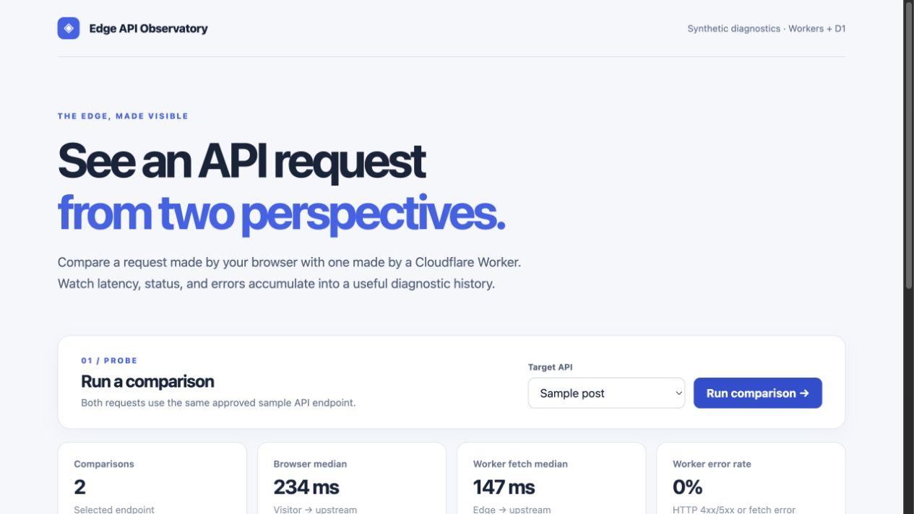

# Edge API Observatory

A small synthetic diagnostics dashboard for learning Cloudflare Workers and D1. It measures the same approved sample API from two places: directly in the visitor's browser and through a Cloudflare Worker. The Worker records comparisons in D1, and the React dashboard shows recent latency, status, and error results.



## What works now

- React + TypeScript + Vite dashboard, served with the Cloudflare Vite plugin.
- TypeScript Worker with `GET /api/targets`, `GET /api/probes`, and `POST /api/probes`.
- Two fixed JSONPlaceholder sample endpoints. The Worker never accepts an arbitrary destination URL.
- Browser-direct fetch and Worker-upstream fetch measured sequentially against the selected endpoint.
- D1 migration and recent-history table; median durations and Worker error rate for the selected endpoint.
- A simple history chart without a charting dependency.
- Probe requests accept only JSON and at most 2 KiB of input. Upstream bodies are read up to 64 KiB.
- A Cloudflare rate-limit binding provides a shared anonymous budget of 10 probes per minute per Cloudflare location. The limit is approximate.
- Five Worker tests cover the allowlist, invalid input, rate-limit response, D1 persistence, and an oversized upstream response.

The hardened local release candidate was verified in a browser: both paths returned HTTP 200, and the result remained in D1-backed history after a page refresh. `npm run typecheck`, `npm run test`, and `npm run build` pass.

This is **synthetic testing**, not passive monitoring of an existing API's real traffic. Browser timings are client-reported. Direct browser tests can fail because of CORS, and a difference between browser-direct and Worker-proxied durations does not isolate Worker overhead. The Worker fetch timing includes reading the response body. Worker handler timing is measured internally but is not shown as a precise CPU measurement.

## Requirements

- Node.js 22 or newer
- npm
- A Cloudflare account only when deploying or creating the remote D1 database

Wrangler, Vite, TypeScript, and Vitest are **project dependencies** in `package.json`; no global installation is needed. Run `npm ci` from this folder to install the versions in `package-lock.json`, then use `npx wrangler ...` for direct Wrangler commands. A bare `wrangler` command is not normally on your shell's global `PATH`.

## Run locally

```bash
npm ci
npm run db:migrate:local
npm run dev
```

Open the URL printed by Vite. Local development uses a simulated D1 database. If the database is empty or the app reports a database error, apply the local migration again.

## Deploy

1. Run `npx wrangler login --device` and complete the browser verification. Then confirm with `npx wrangler whoami`. The device flow avoids reliance on a short-lived localhost callback.
2. Create a D1 database named `edge-api-observatory` with `npx wrangler d1 create edge-api-observatory`.
3. Replace `local-edge-api-observatory` in `wrangler.jsonc` with the database ID returned by Cloudflare, then run `npm run types`.
4. Apply remote migrations with `npm run db:migrate:remote`.
5. Run `npm run deploy`.

The placeholder database ID is only for local development; a remote deployment needs a real ID. This project has not been deployed yet.
The rate limit is now present; it is approximate and local to each Cloudflare location, so it is suitable for a small portfolio demo rather than a strict global quota.

## Commands

| Command | Purpose |
| --- | --- |
| `npm run dev` | Start the local Vite and Worker runtime |
| `npm run typecheck` | Check the React, Worker, and config TypeScript |
| `npm run types` | Regenerate binding/runtime types after changing `wrangler.jsonc` |
| `npm run test` | Run Worker tests in the Cloudflare runtime |
| `npm run build` | Typecheck and build the frontend/Worker |
| `npm run db:migrate:local` | Apply the D1 schema locally |
| `npm run db:migrate:remote` | Apply the D1 schema remotely |
| `npm run deploy` | Build and deploy to Cloudflare |

## Layout

```text
src/                 React dashboard and styles
worker/index.ts      Worker API and D1 access
shared/contracts.ts  Shared target list and data types
migrations/          Versioned D1 schema
vite.config.ts       React and Cloudflare Vite plugins
wrangler.jsonc       Worker, assets, and D1 binding
worker-configuration.d.ts  Generated binding/runtime types
test/                Worker tests and migration setup
vitest.config.ts     Cloudflare Vitest runtime configuration
```

## Next improvements

Add a controlled test endpoint with configurable delay/error responses and optional Cloudflare traces. Keep this README in sync as those features are implemented.

See `RELEASE_PLAN.md` for the initial release gates and `RELEASE_LOG.md` for the entry included with each commit and the current release status.
