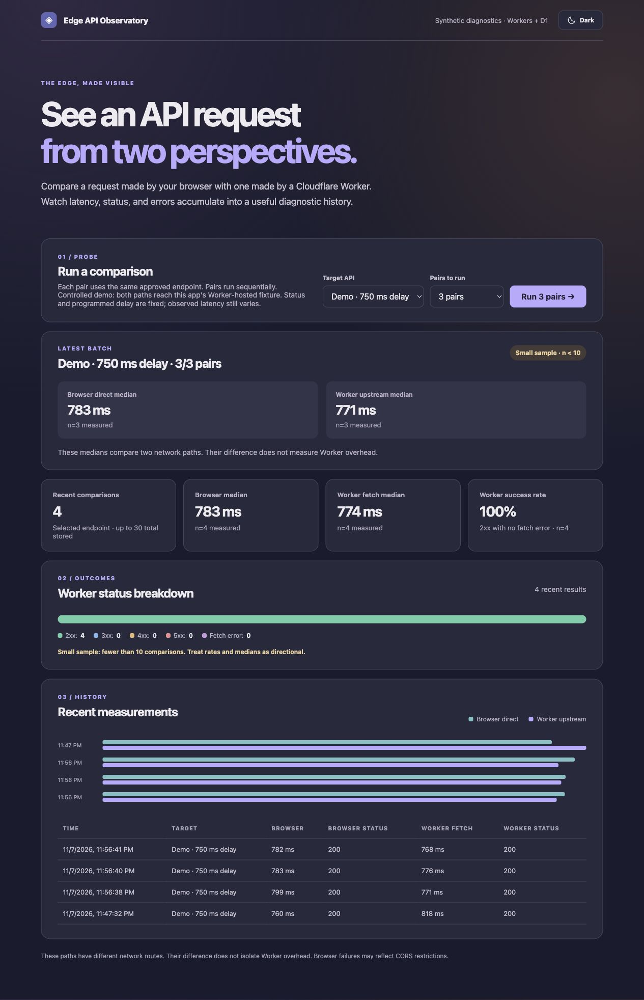

# Edge API Observatory

A small synthetic diagnostics dashboard for learning Cloudflare Workers and D1. It measures the same approved endpoint from two places: directly in the visitor's browser and through a Cloudflare Worker. The Worker records comparisons in D1, and the React dashboard shows recent latency, status, and error results.



See [Investigation 001: controlled delay](docs/investigation-001-controlled-delay.md) for a reproducible local case study, architecture diagram, measured medians, and screenshots.

## What works now

- React + TypeScript + Vite dashboard, served with the Cloudflare Vite plugin.
- TypeScript Worker with `GET /api/targets`, `POST /api/probes`, paired `GET /api/probes`, and individual-result `GET /api/history`.
- Two fixed JSONPlaceholder sample endpoints and three Worker-hosted demo fixtures. The Worker never accepts an arbitrary destination URL.
- Controlled `GET /api/demo/success`, `/api/demo/delay`, and `/api/demo/error` routes return HTTP 200 immediately, HTTP 200 after a programmed 750 ms wait, and HTTP 503, respectively. Responses are uncached JSON.
- Each `POST /api/probes` receives a UUID request ID in the JSON result and `X-Request-ID` response header, including rejected requests. The result carries upstream status, fetch duration, and a stable error category.
- Run a batch of three or five browser-direct/Worker-proxied pairs against the same selected endpoint. Each pair runs sequentially and is stored in D1.
- Versioned D1 migrations and a `probe_samples` table with one row per request mode. Each row stores its timestamp, endpoint ID, mode, duration, status, and error category; Worker rows also store handler duration through the primary D1 commit.
- Dashboard with latest-batch medians for browser-direct fetch, Worker upstream fetch, Worker handler, and browser POST round trip; a recent runs table; a latency chart; Worker status breakdown; and Worker success rate. The latest batch and any history with fewer than ten comparisons are labeled as small samples.
- A sun/light and crescent-moon/dark toggle with a muted light palette and a blue-violet-brown dark palette. The app uses the operating system preference until you choose a theme, then remembers that choice in local browser storage.
- Probe requests accept only JSON and at most 2 KiB of input. Upstream bodies are read up to 64 KiB.
- A Cloudflare rate-limit binding provides a shared anonymous budget of 10 probes per minute per Cloudflare location. The limit is approximate.
- Worker unit and D1 integration tests cover the allowlist, invalid input, rate-limit response, persistence, oversized responses, and success, HTTP-error, timeout, and network-error categories. React DOM tests cover batch interactions, history and error states, theme preference, and bootstrap.

The hardened local release candidate was verified in a browser: both paths returned HTTP 200, and the result remained in D1-backed history after a page refresh. `npm run typecheck`, `npm run test:coverage`, and `npm run build` pass.

### Test coverage

`npm run test:coverage` runs separate Cloudflare Worker and React DOM suites. Each suite enforces **100% statements, branches, functions, and lines per production TypeScript file**. The covered runtime files are `worker/index.ts`, `shared/contracts.ts`, `src/metrics.ts`, `src/App.tsx`, `src/theme.ts`, and `src/main.tsx`. Configuration, generated declarations, CSS, SQL migrations, and test code are outside that metric. This coverage gate checks executed paths; it does not prove correctness on Cloudflare's production network. The CI workflow runs the same gate on pushes to `main` and pull requests. HTML and JSON reports are written to the ignored `coverage/worker` and `coverage/ui` folders.

This is **synthetic testing**, not passive monitoring of an existing API's real traffic. Browser timings are client-reported. Direct browser tests can fail because of CORS, and a difference between browser-direct and Worker-proxied durations does not isolate Worker overhead. The Worker fetch timing includes reading the response body. Worker handler time is wall time, not CPU time. It starts at Worker request entry and includes rate limiting, validation, upstream fetch, and the primary D1 batch commit. The Worker then writes that measured value to its D1 row, so the timing-metadata update and response delivery fall outside the recorded interval. Browser POST round trip starts immediately before `fetch("/api/probes")` and stops after its JSON response is read. It includes browser-to-Worker network time, Worker processing, and response transfer. These durations overlap and cannot be added or subtracted as independent stages. For demo fixtures, the browser directly requests the app's Worker-hosted fixture, while the probe Worker fetches that same public URL. This is a controlled same-origin comparison, not an external upstream benchmark. The programmed delay and HTTP statuses are repeatable; measured latency can still vary.

Cloudflare's `global_fetch_strictly_public` compatibility flag allows the probe Worker to fetch its own public fixture URL. The fixture route handles requests directly and never starts another probe. Local self-fetch has been verified; public deployment must still be checked after Cloudflare authentication.

The latest-batch panel compares medians only from the pairs just run in this browser session; it clears on refresh. The browser POST timing is known only after the POST completes, so it is attached to the current page's result and recent-runs table, not sent in that POST or stored in D1. Historical results show it as unavailable after refresh. The persistent summary uses the selected endpoint's records within the 30 most recent comparisons returned by D1. Each median shows its own count of measured durations. Worker success rate is the percentage of those comparisons with an HTTP 2xx upstream response and no fetch error. The status breakdown groups Worker outcomes into 2xx, 3xx, 4xx, 5xx, and fetch errors. These rates and medians are directional when the sample size is small.

### Probe API result

Send JSON such as `{"targetId":"sample-post","directDurationMs":null,"directStatus":null,"directError":null}` to `POST /api/probes`. A successful probe record returns HTTP 201, even if the approved upstream itself returns an HTTP error; inspect `workerStatus` and `workerErrorCategory` for the upstream outcome. Key fields include:

```json
{
  "requestId": "UUID",
  "targetId": "sample-post",
  "workerStatus": 200,
  "workerFetchDurationMs": 148,
  "workerHandlerDurationMs": 156,
  "browserPostRoundTripMs": null,
  "workerErrorCategory": "none"
}
```

The complete response also contains the persisted run `id`, timestamp, browser-reported direct measurements, and Worker error detail. `browserPostRoundTripMs` is `null` in the API response because only the browser can measure the completed POST. `requestId` equals `id` for a stored run. Error categories are `none`, `http_error`, `timeout`, `network_error`, and `response_too_large`. A timeout is set to eight seconds; upstream response bodies are capped at 64 KiB. Rejected probe requests and internal failures also include a request ID for correlation.

### Individual result history

`GET /api/history` returns individual D1 rows, newest first. Optional query parameters are `endpointId` (an approved target ID), `mode` (`browser_direct` or `worker_proxy`), and `limit` (1–100, default 30). For example:

```text
/api/history?endpointId=sample-post&mode=worker_proxy&limit=20
```

Each row has `requestId`, `observedAt`, `endpointId`, `requestMode`, `fetchDurationMs`, `handlerDurationMs`, `status`, `errorCategory`, and `errorDetail`. Browser and Worker rows share a request ID. `GET /api/probes` continues to return up to 30 paired comparisons for the dashboard. Migration `0002_individual_probe_samples.sql` converts existing paired records into individual rows before removing the old table.

## Requirements

- Node.js 22 or newer
- npm
- A Cloudflare account only when deploying or creating the remote D1 database

Wrangler, Vite, TypeScript, and Vitest are **project dependencies** in `package.json`; no global installation is needed. Run `npm ci` from this folder to install the versions in `package-lock.json`, then use `npx wrangler ...` for direct Wrangler commands. A bare `wrangler` command is not normally on your shell's global `PATH`.

## Run locally

```bash
npm ci
npm run db:migrate:local
npm run dev
```

Open the URL printed by Vite. Local development uses a simulated D1 database. If the database is empty or the app reports a database error, apply the local migration again.

## Deploy

1. Run `npx wrangler login --device` and complete the browser verification. Then confirm with `npx wrangler whoami`. The device flow avoids reliance on a short-lived localhost callback.
2. Create a D1 database named `edge-api-observatory` with `npx wrangler d1 create edge-api-observatory`.
3. Replace `local-edge-api-observatory` in `wrangler.jsonc` with the database ID returned by Cloudflare, then run `npm run types`.
4. Apply remote migrations with `npm run db:migrate:remote`.
5. Run `npm run deploy`.

The placeholder database ID is only for local development; a remote deployment needs a real ID. This project has not been deployed yet.
The rate limit is now present; it is approximate and local to each Cloudflare location, so it is suitable for a small portfolio demo rather than a strict global quota.

## Commands

| Command | Purpose |
| --- | --- |
| `npm run dev` | Start the local Vite and Worker runtime |
| `npm run typecheck` | Check the React, Worker, and config TypeScript |
| `npm run types` | Regenerate binding/runtime types after changing `wrangler.jsonc` |
| `npm run test` | Run Worker and React DOM test suites |
| `npm run test:worker` | Run Worker unit and D1 integration tests in the Cloudflare runtime |
| `npm run test:ui` | Run React DOM and theme tests in jsdom |
| `npm run test:coverage` | Run both suites with per-file 100% coverage gates |
| `npm run build` | Typecheck and build the frontend/Worker |
| `npm run db:migrate:local` | Apply the D1 schema locally |
| `npm run db:migrate:remote` | Apply the D1 schema remotely |
| `npm run deploy` | Build and deploy to Cloudflare |

## Layout

```text
src/                 React dashboard, theme preference, and styles
worker/index.ts      Worker API and D1 access
shared/contracts.ts  Shared target list and data types
migrations/          Versioned D1 schema and data conversion
vite.config.ts       React and Cloudflare Vite plugins
wrangler.jsonc       Worker, assets, and D1 binding
worker-configuration.d.ts  Generated binding/runtime types
test/                Worker tests and migration setup
vitest.config.ts     Cloudflare Vitest runtime configuration
vitest.ui.config.ts  React DOM Vitest configuration
.github/workflows/ci.yml  Typecheck, coverage, and build gate
```

## Next improvements

Consider optional Cloudflare traces and a separate fixture Worker if an independent upstream is needed. Keep this README in sync as those features are implemented.

See `RELEASE_PLAN.md` for the initial release gates and `RELEASE_LOG.md` for the entry included with each commit and the current release status.
