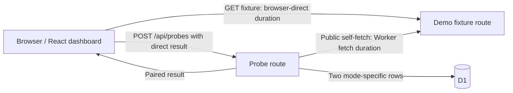
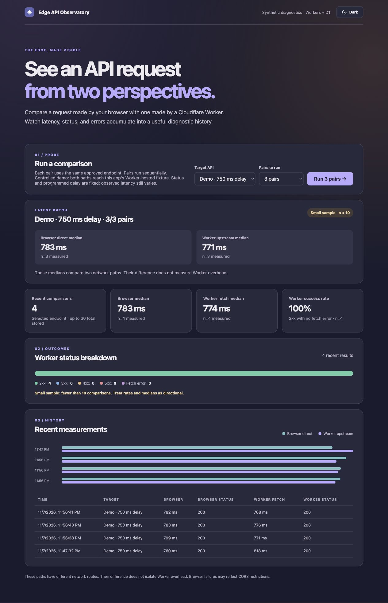
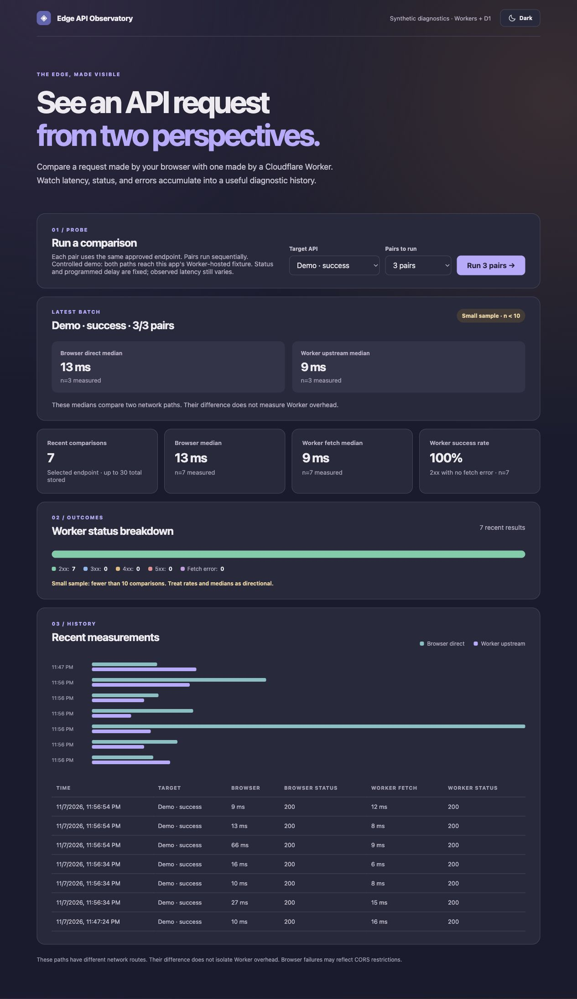

# Investigation 001: a controlled delay appears on both request paths

**Observed:** 2026-11-07, about 11:56 p.m. America/New_York, in the local Vite and Cloudflare Worker runtime.  
**Question:** When the selected fixture waits 750 ms before responding, do both measured request paths show the delay?  
**Result:** Yes. The three-pair Worker fetch median rose from 8 ms to 771 ms, then returned to 9 ms after selecting the immediate-success fixture again. The browser-direct medians followed the same pattern. All nine requests on each path returned HTTP 200.

## Architecture and measurement points

The fixture and probe routes run in the **same Worker**. The browser fetches `/api/demo/success` or `/api/demo/delay` directly. A separate `POST /api/probes` asks the Worker to fetch that same fixture URL, then stores the browser-reported and Worker-measured results in D1. The delayed fixture waits 750 ms before returning uncached JSON and HTTP 200.

## Reproduction

1. Run `npm ci`, `npm run db:migrate:local`, and `npm run dev`.
2. In the dashboard, select **Demo · success** and run **3 pairs**.
3. Select **Demo · 750 ms delay** and run **3 pairs**.
4. Select **Demo · success** and run **3 pairs** again.
5. Read each **Latest batch** median, which excludes older D1 history. The paired rows remain available through `GET /api/history`.

| Latest batch | Browser-direct median | Worker fetch median | HTTP status on both paths |
| --- | ---: | ---: | --- |
| Immediate success | 16 ms (n=3) | 8 ms (n=3) | 200 for all 3 pairs |
| Programmed 750 ms delay | 783 ms (n=3) | 771 ms (n=3) | 200 for all 3 pairs |
| Immediate success again | 13 ms (n=3) | 9 ms (n=3) | 200 for all 3 pairs |

Compared with the first success batch, the delayed batch increased by **767 ms** on the browser-direct path and **763 ms** on the Worker fetch path. The small differences from the programmed 750 ms are expected: both measurements include other work and local runtime scheduling. The return to near-baseline values after switching back supports the fixture delay as the cause of the rise in this local run.

## Screenshots

*Delayed batch: 783 ms browser-direct and 771 ms Worker fetch medians, with n=3 on each path. The summary card below includes one older delayed run, so its n=4 values differ from the latest-batch panel.*

*Recovery batch: 13 ms browser-direct and 9 ms Worker fetch medians, with n=3 on each path.*

## Interpretation and limits

This is a **local, controlled fixture test**, not evidence about a third-party API or production Cloudflare latency. Each batch contains only three pairs and is labeled a small sample in the UI. The programmed delay is stable; observed durations can vary.

The app does **not** separately measure browser-to-Worker round-trip time for `POST /api/probes`. Therefore this run cannot support a claim that browser-to-Worker time stayed similar. Browser-direct duration includes the browser's fetch and response-body read. Worker fetch duration includes its fetch and response-body read. Their difference is not a Worker-overhead estimate. A follow-up investigation could add a client-side `POST /api/probes` round-trip measurement and compare it with the Worker handler timing while keeping the same fixture.
